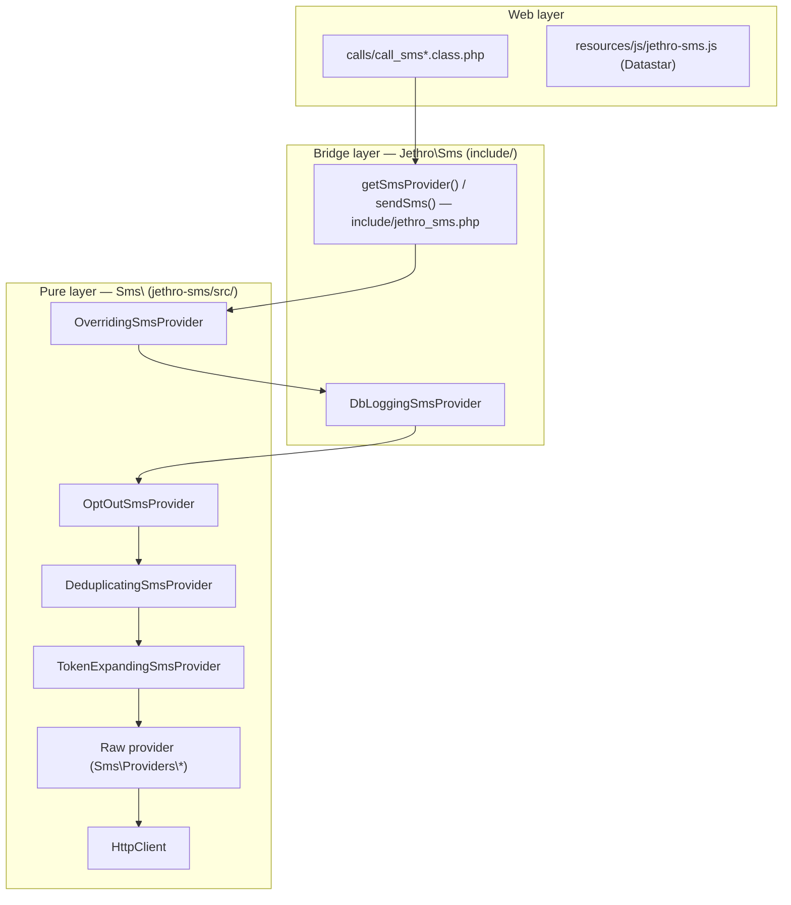

# SMS Architecture

## Overview

Jethro's SMS code is split into three tiers:

1. **Pure layer** (`Sms\`, `Sms\Providers\`): the standalone **jethro-sms package** at `jethro-sms/`. It contains the provider implementations and the generic decorators, and has no Jethro dependencies. Pure functions sit at the core, with the impure parts (HTTP, cache) at the edges. Errors are returned as `\Result` throughout.
2. **Bridge layer** (`Jethro\Sms\`): connects the package to Jethro's database, session, permissions and person records. It lives in `include/jethro_sms.php` and `include/Jethro/Sms/`, and includes the HTML renderers.
3. **Web layer**: the `calls/call_sms*.class.php` AJAX/SSE handlers, templates, and `resources/js/jethro-sms.js`.

The seam is the `Sms\SmsProvider` interface. Every decorator and raw provider implements it, so code above it works the same whichever gateway is configured.



Dependencies run strictly downwards: web → bridge → pure. The pure package can be built and tested independently, and its end product is the `jethro-sms/bin/jethro-sms` CLI. Decisions made when it was extracted are recorded in `jethro-sms/docs/extraction.md`.

Why the layering matters:

- **Test isolation**: pure-layer tests need no database or session (see [Unit tests](#unit-tests)).
- **Shared code path**: `scripts/sms.php`, the cron reminder scripts and the web UI all send through `getSmsProvider()`.
- **Provider swapping**: `SMS_PROVIDER` (or auto-detection) chooses the raw provider, and nothing above the interface changes.

## Package boundary

- Jethro loads the package through `jethro-sms/src/load.php`, which `include/jethro_sms.php` requires.
- Each file holds one class: `Sms\Foo` → `jethro-sms/src/Foo.php`, `Sms\Providers\Foo` → `jethro-sms/src/Providers/Foo.php`, `Jethro\Sms\Foo` → `include/Jethro/Sms/Foo.php`, `Jethro\Sms\Providers\Foo` → `include/Jethro/Sms/Providers/Foo.php`.
- Provider selection and auto-detection live in `Sms\resolveRawProviderClass()` (`src/factory.php`).
- The statusline and preview maths and renderers are in `Sms\` (`src/sms_statusline.php`). The bridge builds the Jethro-state snapshot for them with `Jethro\Sms\makeStatuslineConfig()`.
- `TokenExpandingSmsProvider` receives URL-shortener closures by injection, so the package never calls Jethro's shortener directly.
- `\Result` has its canonical definition in `jethro-sms/src/result.php`, which `include/general.php` also requires.
- `src/sms.php`, `src/sms_cellcast.php` and `src/templater.php` are left over from the pre-split monoliths and are **out of date**. `sms.php` does not load the dedup and opt-out decorators or the Cellcast provider. `sms_cellcast.php` requires paths that moved into `Providers/`. Use `load.php`.

## Provider chain

`Jethro\Sms\getSmsProvider()` (`include/jethro_sms.php`) builds the chain from the inside out. It rebuilds it on every call rather than memoizing it: constants can't change within a request, and the token resolver's person-row cache is per invocation.

```
OverridingSmsProvider → DbLoggingSmsProvider → OptOutSmsProvider → DeduplicatingSmsProvider → TokenExpandingSmsProvider → RawProvider
```

The three middle decorators are added **only when `$logToDb` is true**. 2FA sends use `$logToDb = false`, so their chain is `Overriding → TokenExpanding → Raw`. Every decorator except `DbLoggingSmsProvider` extends `Sms\DecoratingSmsProvider`, which forwards every method by default.

**Every send is a batch.** `send()` takes an array of *entries* (`[{message, recipients[]}, …]`) together with one sender, `$sendAt` and `$preview`. A single message is a batch with one entry. The whole send action, including per-recipient message overrides, passes through the chain in **one** `send()` call.

1. **Raw provider** (5CentSMS v5, Cellcast, Template, v4). It is built with `fromConstants($tfa, …)` and given a `SessionSmsCache` keyed by a config fingerprint: xxh3 of the class name plus every `getConstants()` name=value pair. A change to the settings therefore invalidates the cache.
2. **`TokenExpandingSmsProvider`** walks the entries.
   - **Known variables** (`firstname`, `lastname`, `fullname`, from `getAvailableTokens()`): an entry whose message uses one is split into one entry per recipient with the expanded text. Person data comes from the injected token resolver.
   - **Shared numbers**: when an entry carries `logicalRecipients` (see step 3), the expansion is done **per number** instead, with token values joined by " & " ("Hi Alice & Bob, …").
   - **Function-only tokens** (e.g. `%(shorten url)%`) are expanded once for the whole entry.
   - **Entries without tokens** pass through unchanged, so the raw provider can still make one multi-recipient HTTP call. A bare `%` (as in "20% off") does not trigger expansion.
   - Expanded entries keep the pre-expansion text under a `template` key.
   - The bridge injects an s-expression `Templater` with a `concat` function registered. A `shorten` function is registered per send: the preview closure in preview mode, and the real closure (which stores the mapping) otherwise.
3. **`DeduplicatingSmsProvider`** sends one message per **phone number**.
   - Recipients who share a number (e.g. a child listed on a parent's mobile) are grouped by `PhoneNumber::sameNumberKey()`.
   - Each entry's `recipients` are reduced to one primary per number, and a parallel `logicalRecipients` array records who each delivery is for.
   - The results are then fanned back out to one delivery per person, in the original recipient order. Non-primary rows carry `segments_used` 0 and `costBearer` false.
   - Previews take the same path.
   - **Order contract: inside DbLogging, outside TokenExpanding.**
4. **`OptOutSmsProvider`** never sends to a number on the provider's opt-out list.
   - The list comes from `listOptOuts()`, which the raw provider caches in the session, and numbers are matched by `sameNumberKey()`.
   - Opted-out recipients are removed before the inner chain sees them. An entry left empty is dropped, and if everyone opted out, no inner call is made.
   - Each opted-out recipient gets a placeholder delivery (`SmsStatus::OPTED_OUT`, 0 segments, not the cost bearer), merged back in the original order.
   - DbLogging does not record these placeholders.
   - It fails open: if the provider lacks `LIST_OPT_OUTS` or the lookup fails, nobody is filtered.
   - **Order contract: inside DbLogging, outside Deduplicating.**
   - `Call_SMS` reports `failed_opted_out` from the batch statuses.
5. **`Jethro\Sms\Providers\DbLoggingSmsProvider`** is the only bridge decorator. It intercepts `send()`, `registerSenderNumber()`, `verifySenderNumber()`, `updateDelivery()`, `cancel()` and `listRecentDeliveries()`.
   - **`send()`**: first checks that token-bearing entries have only `JethroSmsRecipient` recipients. It then inserts **one `sms` row** for the batch (holding the first entry's `template`, or its message if there is no template) and one `smsdelivery` row per delivery, and wraps each delivery in a `JethroSmsDelivery`. In preview mode it writes nothing.
   - **`updateDelivery()`**: caches results in the DB and stops polling upstream once a status is final.
   - **`cancel()` and `listRecentDeliveries()`**: the statuses they return are persisted.
6. **`OverridingSmsProvider`** is the outermost decorator.
   - It enforces the `SMS_SENDER_OPTIONS` allowlist on all sends, and `SMS_SENDER` on user-initiated sends only. A mismatch returns `Result::failure`; it does not throw.
   - It resolves `_USER_MOBILE_` against its `userMobile:` argument.
   - It applies the `SMS_SEND_COOLOFF` undo delay (default 30 s) to immediate sends when two conditions hold:
     - `userInitiated` is true. This is `$logToDb && PHP_SAPI !== 'cli'`, so 2FA, the cron reminders and the CLI skip it.
     - The inner provider has both `DEFERRED_SEND` and `DEFERRED_SEND_CANCEL`.
   - It sits outside DbLogging so that the DB records the `sendAt` after the cool-off is applied.

## Provider selection

`SMS_PROVIDER` accepts a short key (`'5centsmsv5'`, `'cellcast'`), a fully-qualified class name, or `'auto'`/undefined. In auto mode, `Sms\providerCandidates()` sorts the providers by `usagePreference()` (descending), and the first one whose *required* `getConstants()` are all defined wins:

| Preference | Provider | Required constants |
|---|---|---|
| 10 | `FiveCentSmsV5Provider` | `SMS_5CENTSMS_APIKEY_ID`, `SMS_5CENTSMS_APIKEY` |
| 9 | `CellcastSmsProvider` | `SMS_CELLCAST_APIKEY` |
| -1 | `FiveCentSmsV4Provider` (deprecated; extends Template) | `SMS_HTTP_HEADER_TEMPLATE`, **and** `SMS_HTTP_URL` must be exactly `https://www.5centsms.com.au/api/v4/sms` or `…/api/v4` |
| -2 | `TemplateSmsProvider` (generic HTTP catch-all) | `SMS_HTTP_URL`, `SMS_HTTP_POST_TEMPLATE`, `SMS_HTTP_RESPONSE_OK_REGEX` |

Providers with a negative preference are left out of the "not configured" help text.

### Config constants and the 2FA fallback

Each provider reads its own constants in `fromConstants(bool $tfa)`. When `$tfa` is true, each field tries its `2FA_*` variant first and falls back to `SMS_*` field by field. A 2FA chain can therefore share credentials with ordinary SMS sends simply by leaving the `2FA_*` constants undefined.

`SMS_SENDER` (with `SENDER_ID` as a deprecated fallback) is enforced by `OverridingSmsProvider` and also supplies the default sender in `getSenderFromRequest()`. 2FA takes its sender from `2FA_SENDER_ID`. If that is empty, `User_System` falls back to `SMS_SENDER`, unless `SMS_SENDER` is `_USER_MOBILE_`: nobody is logged in during 2FA, so that case needs a literal `2FA_SENDER_ID`.

Other cross-cutting constants (`SMS_SEND_COOLOFF`, `SMS_SHORTEN_URLS`, …) are read in `include/jethro_sms.php` and `OverridingSmsProvider`. See [Configuration Reference](./configuration).

## Capabilities

`Sms\SmsCapability` is an enum of feature flags. Callers gate UI and behaviour on `hasCapability()` before calling the matching method.

| Capability | Method | v5 | Cellcast |
|---|---|---|---|
| `GET_BALANCE` | `getBalance()` | ✓ | ✓ |
| `GET_SENDER_IDS` | `getSenderIds()` | ✓ | ✓ (business names) |
| `DEFERRED_SEND` | `send(…, $sendAt)` | ✓ | ✓ |
| `DEFERRED_SEND_CANCEL` | `cancel()` | ✓ | ✓ |
| `REGISTER_SENDER_NUMBER` | `registerSenderNumber()` | ✓ | ✓ |
| `REGISTER_SENDER_ID` | `registerSenderId()` | ✓ | ✓ |
| `LIST_OPT_OUTS` | `listOptOuts()` | ✓ | ✓ |
| `REMOVE_OPT_OUT` | `removeOptOut()` | ✓ | |
| `BATCH_DELIVERY_QUERY` | `listRecentDeliveries()` | ✓ | ✓ |
| `LIST_HISTORY` | used by `synchronizeHistory()` | ✓ | ✓ |

v4 has `GET_BALANCE` only. Template has `GET_BALANCE` only when a balance URL is configured.

- `getSenderIds(bool $getAll = false)` returns only ACMA-approved sender IDs unless `$getAll` is true.
- `listRecentDeliveries(?int $since = null)` returns delivery statuses since a timestamp (default: the last 24 h) from one paginated upstream query. Providers without the capability return `[]`, and callers then fall back to per-delivery `updateDelivery()`.
- `getDeferredSendMaxDelay(): ?int` is how far ahead a send may be scheduled: 365 days for v5, 24 h for Cellcast, and `null` (no limit) for Template. Callers use it as the `max` on schedule inputs and validate against it server-side.

## Senders

### Sender IDs and sender numbers

v5's `GET /v5/senderid` returns a single list that mixes alphanumeric IDs and phone numbers. The provider splits it:

- **`getSenderIds()`**: alphanumeric entries only (via `filterOutPhoneNumbers()`), ACMA-approved only by default.
- **`getSenderNumbers()`**: approved phone-number entries (via `fetchSendersFromApi()` → `parseSenderIds()`).

Both share the session cache key `sms_senderids`, with a TTL of 30 minutes. Cellcast fetches sender numbers from `customNumber` and sender IDs from `business`, also with a 30-minute TTL.

When `SMS_SENDER_OPTIONS` is set, `OverridingSmsProvider::getSenderIds()` builds the sender list from it.

`Sms\senderFromString()` (`src/functions.php`) is the single definition of "phone-number-like". After trimming, removing spaces and one leading `+`:
- all digits and at least 7 characters → `PhoneNumber`;
- anything else (e.g. `StBarnabas`, or the short code `12345`) → `SenderID`;
- empty → `null`.

All four places that parse a configured or typed sender use it:
- `SMS_SENDER` in `getSenderFromRequest()`;
- `2FA_SENDER_ID` in `User_System`;
- `SMS_FROM` in `scripts/roster_reminder.php`;
- `--from` in the CLI.

### Registration: an opaque state machine

Registering a sender ID or sender number is a provider-specific state machine hidden behind two signatures:

```php
public function registerSenderId(?SenderID $senderId = null, ?array $params = null): \Result;
public function registerSenderNumber(?ContactPhoneNumber $contact = null, ?array $params = null): \Result;
```

Callers loop: render the step's `fields` as a form, collect the input, then call again with the domain object and the collected params. They stop when `RegistrationStep::isComplete()` (i.e. `fields` is empty).

```
registerSenderId(null, null)            // → form asking for sender ID
registerSenderId($sid, null)            // → compliance form (or failure)
registerSenderId($sid, $params)         // → done
registerSenderNumber(null, null)        // → mobile + name form
registerSenderNumber($contact, null)    // → OTP field (Cellcast) or wait-for-link (v5)
registerSenderNumber($contact, $params) // → done
```

Each call returns `\Result<RegistrationStep, string>`. `Sms\RegistrationStep` is a final readonly value object with no presentation logic; `with()` returns a modified copy:

| Property | Type | Meaning |
|---|---|---|
| `message` | `string` | Plain-text outcome headline |
| `fields` | `FormField[]` | Fields to render next (empty = done) |
| `instructions` | `string` | Next-step guidance (optional) |
| `contact` | `string` | Email or contact to act on (optional) |
| `form` | `array<{label, value}>` | Compliance details to display or email (optional) |
| `number` | `?string` | Verified sender number (set on completion) |
| `registered` | `bool` | Whether the registration is confirmed upstream |

Steps are rendered by `Jethro\Sms\renderRegistrationStepHtml()` on the web and by `renderRegistrationStepText()` (`jethro-sms/src/cli.php`) on the CLI.

### Verified sender numbers: first person wins

`DbLoggingSmsProvider` records numbers in `sms_registered_sender` against the person they were verified for. A number is claimed for the current user in two cases:
- a completed registration (`registered && number`);
- `verifySenderNumber()` sees the provider report a verified number that nobody has claimed yet.

A number already claimed by someone else is never treated as verified for you, whatever the provider says. Providers can't prove that someone possesses a number that is already on the account (Cellcast skips the OTP), hence the first-person-wins rule.

At send time, `senderNotVerifiedError()` (called by `Call_SMS`) refuses to send as your own mobile on a `REGISTER_SENDER_NUMBER` provider unless that number is verified for you. `Call_SMS_Sendernum` only lets you verify your own mobile.

5CentSMS v5 verifies by an SMS link rather than an OTP, so its registration step returns `registered: false`. Once the number shows as approved upstream, `verifySenderNumber()` → `getSenderNumbers()` picks it up and DbLogging claims it.

## Send flow (web)

1. The composer posts to `?call=sms` (`Call_SMS`).
2. Recipients are parsed from the request (`getRecipientsFromRequest()`), and the sender comes from `getSenderFromRequest()`.
3. `messageOverridesFromRequest()` returns a `rowKey => text` map built from edited preview rows. A row key is the row's person IDs joined with `_` (e.g. `140_142` for a shared mobile).
4. Recipients are split into standard and overridden. The entries are the standard entry first (`['message' => $template, 'recipients' => $standard]`), then one entry per distinct override text, so the people on a shared-mobile row stay together.
5. Everything is sent in one call: `sendSms($entries, [], sender: $sender, sendAt: $sendAt, shortenUrls: shortenUrlsFromRequest())`.
6. `sendSummary()` matches deliveries to recipients by position and returns a `SendSummary` (`AllSent` | `PartialSuccess` | `Failed`).

`sendSms()` takes either `('Hello', $recipients, $sender)` or `($entries, [], $sender)`. Its full signature is `(string|array $messageOrEntries, array $recipients, SmsSender $sender, ?int $sendAt = null, bool $preview = false, bool $logToDb = true, bool $shortenUrls = false)`.

`send()` returns `\Result<SmsDeliveryBatch, string>`. Raw providers leave `$batchId` null. DbLogging returns a `JethroSmsDeliveryBatch` whose `batchId` is the `sms.id` and which also carries `senderPersonId`. DbLogging returns a plain batch with a null `batchId` in two cases:
- **The DB insert failed after the gateway accepted the send.** The send still counts as successful (the messages went out) and the failure is logged loudly.
- **Every recipient had opted out**, so no `sms` row was written.

### URL auto-shortening

With `shortenUrls: true`, `sendSms()` wraps bare URLs longer than 26 characters in `%(shorten "…")%`, skipping any entry that already contains `%(shorten`. Only the SMS form turns this on, via its **Shorten URLs** checkbox (`shorten_urls`, read by `shortenUrlsFromRequest()` in both `Call_SMS` and `Call_SMS_Statusline`). Cron reminders, 2FA and the CLI never auto-shorten. `SMS_SHORTEN_URLS` only sets the checkbox's default.

The checkbox is rendered on the server by `renderShortenUrlsToggle()` into `#sms-shorten-toggle<suffix>` and re-patched by the statusline endpoint on every composer post. It is only shown when all three hold:
- `URLSHORTENER` and `URLSHORTENER_API_KEY` are set;
- the message contains a URL that would be wrapped (`Sms\shortenUrlsInText()`);
- the message has no explicit `%(shorten …)%` token, since an explicit token disables auto-shortening.

When the checkbox is hidden, the current choice is carried in a hidden `shorten_urls` input.

### Live statusline and preview (Datastar)

The cost/segment line and the per-recipient preview panel are **rendered on the server and streamed over Datastar SSE** from `?call=sms_statusline` (`Call_SMS_Statusline`). See [SMS_DATASTAR.md](./SMS_DATASTAR.md).

- The message textarea posts on `input` with a 300 ms debounce. The segment and cost maths is `Sms\` code in `jethro-sms/src/sms_statusline.php`, and no maths runs in JS.
- Preview rows come from `Jethro\Sms\previewRows()`, with **one row per phone number**: people who share a mobile share a row (names one per line, the combined message, key = person IDs joined with `_`). The cost line therefore counts messages, not people. Opted-out rows are shown greyed and can't be edited.
- `Sms\renderPreviewPanel()` adds a pencil button to each row, which reveals a one-line textarea that posts on blur. Edited rows are highlighted and stay edited across re-renders, because the server re-renders them from the posted overrides.
- `Call_SMS` still answers `preview=1` with JSON `{preview: [{key, name, message, status}]}`.

With `$preview = true`, the chain makes no gateway call and no DB write:
- **`TokenExpandingSmsProvider`** expands tokens, sets `SmsDelivery::$message` and returns.
- **`DbLoggingSmsProvider`** skips its inserts.
- **Raw providers** return mock deliveries for anything that reaches them.

### Cancelling

`cancel(SmsDeliveryBatch)` cancels the scheduled deliveries in a send (contract pinned by `jethro-sms/tests/cancel/test_cancel_batch.php`):

- Only each delivery's `remoteId` is used. Other fields are echoed back unchanged.
- The batch-level `Result` is a success whenever the cancel could be attempted. `Result::failure` is reserved for operation-level errors, such as an unsupported provider or an auth failure.
- Each delivery comes back either `CANCELLED`, or with its status **unchanged** and the reason in `statusDetail()`. Gateways report refusals inside an HTTP-200 envelope (e.g. Cellcast `status: false` / "message not found"), so providers must check the envelope, not just the transport result.
- DbLogging persists the returned statuses, so a refused cancel leaves the row `scheduled`.
- `Call_SMS_Cancel` reports counts plus the distinct reasons ("Cancelled 0 deliveries, 3 failed (message not found)."), and morphs only the deliveries that were actually cancelled.

## History sync

Providers with `LIST_HISTORY` / `BATCH_DELIVERY_QUERY` can pull an account's sent-message history. There are two bridge functions in `include/jethro_sms.php`:

- **`checkSynchronized(?int $since)`** returns a text diff between upstream deliveries and the local `sms`/`smsdelivery` rows. An empty result means they are in sync.
- **`synchronizeHistory(?int $since)`** imports the upstream history:
  1. It stages the deliveries in the scratch tables `sms_new`/`smsdelivery_new`.
  2. It refines them in SQL: removes feed duplicates, groups deliveries into batches (a new batch starts after a gap of 1 h or more) and resolves person IDs.
  3. It deletes staged rows that already exist locally. Batches match on body within ±10 minutes; deliveries match on `remote_id` or the last 9 digits of the phone number.
  4. It bulk-inserts what is left.

  Runs are serialised by `GET_LOCK('<db>.sms_sync')`. The scratch-table DDL implicitly commits, so don't call it inside a transaction you need to stay atomic.

The admin UI is `Call_Admin_Sms_Sync_History` (`?call=admin_sms_sync_history`, `PERM_SYSADMIN`): a GET shows a confirmation form and a POST runs the import. The pipeline is described step by step in [history-sync.md](./history-sync.md).

## Value objects

Some small types share a file with a related interface (e.g. `PhoneNumber` lives in `SmsSender.php`).

| Type | Location | Purpose |
|---|---|---|
| `SmsSender`, `SmsRecipient` (interfaces) | `src/SmsSender.php` | Anything usable as a sender or recipient |
| `PhoneNumber` | `src/SmsSender.php` | Digits-only number; both a sender and a recipient. Sent to v5 and Cellcast as entered. `sameNumberAs()`/`sameNumberKey()` (last 9 digits) match local and international forms. Only Template/v4 still use `internationalise()` |
| `ContactPhoneNumber` | `src/SmsSender.php` | `PhoneNumber` plus a `$name` label, used for registration |
| `SenderID` | `src/SmsSender.php` | Alphanumeric/short-code sender, with an optional `$acmaApproved` |
| `OptOutEntry` | `src/SmsSender.php` | One entry on a provider's opt-out list |
| `SmsDelivery` | `src/SmsDelivery.php` | Per-recipient result: status, remote ID, timestamps, raw response, expanded `$message`, transient `$statusDetail`, `segmentsUsed`, `perSegmentCost`, `costBearer`. Has provider subtypes in `src/Providers/` |
| `SmsDeliveryBatch` | `src/SmsDelivery.php` | The deliveries from one `send()` |
| `SmsStatus` (string enum) | `src/SmsStatus.php` | Delivery statuses. See [Status Codes](./status-codes) |
| `SmsCapability` (enum) | `src/SmsCapability.php` | Feature flags |
| `SendSummary` | `src/SendSummary.php` | `AllSent` / `PartialSuccess` / `Failed` |
| `RegistrationStep`, `FormField` | `src/RegistrationStep.php`, `src/FormField.php` | Registration state-machine output |
| `SmsStatuslineConfig` | `src/SmsStatuslineConfig.php` | Config snapshot for the statusline maths |
| `HttpClient` (interface), `HttpRequest`, `HttpResponse`, `NativeHttpClient`, `LoggingHttpClient` | `src/HttpClient.php` | HTTP seam. `NativeHttpClient` is cURL-based and caps identical repeated requests. `LoggingHttpClient` is a verbose decorator |
| `FakeHttpClient` (abstract) | `src/FakeHttpClient.php` | Base for the per-provider fakes in `src/Providers/` (Cellcast, v5, Template) |
| `SmsCache` (interface) | `src/SmsCache.php` | Cross-request provider cache |
| `Templater` | `src/Templater.php` | s-expression `%(fn arg)%` engine |
| `JethroSmsRecipient` | `include/Jethro/Sms/` | `SmsRecipient` with a person ID |
| `JethroSmsDelivery` | `include/Jethro/Sms/` | `SmsDelivery` with a person ID and DB row ID |
| `JethroSmsDeliveryBatch` | `include/Jethro/Sms/` | Batch with a non-null `batchId` (`sms.id`) and a nullable `senderPersonId` |
| `SmsRequestRecipients` | `include/Jethro/Sms/` | Parsed request: recipients, blanks, archived, raw records |
| `SessionSmsCache` | `include/Jethro/Sms/` | `SmsCache` on `$_SESSION`, with fingerprint invalidation |
| `SmsStatusIcon` (enum) | `include/Jethro/Sms/` | Icon per status, shared by the Messages tab and the Messages page |

## Endpoints by provider

### 5CentSMS v5

Auth: `key-id` and `key-secret` in the JSON body of **every** request, GETs included.

| Method | HTTP |
|---|---|
| `send()` | `POST /v5/sms` |
| `getBalance()` | `GET /v5/balance` |
| `getSenderIds()` / `getSenderNumbers()` | `GET /v5/senderid` |
| `updateDelivery()` | `GET /v5/sms/{id}` |
| `listRecentDeliveries()` | `GET /v5/sms`, paged newest-first with an `?after=` cursor until older than `$since`, end of history, or a repeated cursor (about 12 months retained) |
| `cancel()` (per delivery) | `DELETE /v5/sms/{id}` |
| `listOptOuts()` | `GET /optouts` (paged with `?after=`) |
| `registerSenderNumber()` / `registerSenderId()` | `POST /v5/senderid` (+ compliance form for IDs) |

### Cellcast

Auth: Bearer token. In test mode the HTTP client is wrapped in `CellcastFakeHttpClient`, which returns realistic JSON.

| Method | HTTP |
|---|---|
| `send()` | `POST /api/v1/gateway` |
| `getBalance()` | `GET /api/v1/apiClient/account` |
| `getSenderNumbers()` | `GET /api/v1/customNumber` |
| `getSenderIds()` | `GET /api/v1/business` (undocumented) |
| `updateDelivery()` | `GET /api/v2/report/message/{id}` |
| `listRecentDeliveries()` | `GET /api/v2/report/message?campType=sms&fromDate=…&page=N&limit=100` |
| `cancel()` (per delivery) | `POST /api/v1/gateway/cancelScheduleQuickMessage` |
| `listOptOuts()` | `GET /api/v1/apiClient/getOptout?page=&size=` |
| `registerSenderNumber()` | `POST /api/v1/customNumber/add`, then `POST /api/v1/customNumber/verifyCustomNumber` |
| `registerSenderId()` | `POST /api/v1/business/add` |

## Unit tests

There is one runner: `php tests/unit/run.php [filter]` (e.g. `sms/cellcast`). `tests/unit/sms` is a symlink to `jethro-sms/tests/`, so the package's tests run as part of Jethro's suite. The package has no runner of its own: `composer test` in `jethro-sms/composer.json` points at a `tests/run.php` that doesn't exist.

```
jethro-sms/tests/     (run via tests/unit/run.php)
  cancel/       SmsDeliveryBatch cancel() contract
  cellcast/     registration, send/balance parsing, delivery updates
  overriding/   sender allowlist, cooloff, SMS_SENDER mismatch, _USER_MOBILE_
  providers/    v5 / Template parsing, deferred-send max delay
  statusline/   GSM/UCS-2 segment maths, URL shortening, renderStatusline()/renderPreviewPanel()
  summary/      sendSummary() shared-mobile attribution
  token/        token expansion, known-token trigger, partial failure, templater
  values/       PhoneNumber normalisation, senderFromString()
```

Tests use fake or spy `HttpClient`s and make no network calls. They all share one PHP process, so guard any `define()` with `if (!defined(...))` and reuse the values other files have already set. A test that needs its own constants (e.g. `SMS_SENDER`) declares `@isolated-process` in its header docblock. The runner executes it afterwards in a child process (`run.php --isolated <file>`) and adds its counts to the totals.

Functional (Playwright) tests use the mock SMS server at repo-root `smsmockserver/`, served by the same nginx + PHP-FPM, which simulates the Cellcast and 5CentSMS v5 APIs. Per-profile behaviour lives in `tests/functional/sms/<profile>.smsmock.php`. See [DEVELOPMENT_FUNCTESTS.md](../../DEVELOPMENT_FUNCTESTS.md).

## File layout

| File | Contents |
|---|---|
| `jethro-sms/src/load.php` | Canonical package loader |
| `jethro-sms/src/<Class>.php` | `SmsProvider`; the decorators `DecoratingSmsProvider`, `TokenExpandingSmsProvider`, `DeduplicatingSmsProvider`, `OptOutSmsProvider`, `OverridingSmsProvider`; the value objects; `Templater`; the HTTP infrastructure |
| `jethro-sms/src/Providers/` | `FiveCentSmsV5Provider`, `FiveCentSmsV4Provider`, `CellcastSmsProvider`, `SmsBroadcastSmsProvider`, `TemplateSmsProvider`, plus delivery subtypes and fake HTTP clients |
| `jethro-sms/src/functions.php` | `sendSummary()`, `finishStoppedSend()`, `failedEntryDeliveries()`, `statusFromV5Code()`, `senderFromString()`, `senderOptionTokens()`, `excludeUnapprovedSenderIds()`, `messageHasTokens()`, `parseSenderIdsFromCsv()`, `formatDeliveryLine(s)()` |
| `jethro-sms/src/factory.php` | `providerShortNames()`, `providerCandidates()`, `resolveRawProviderClass()` |
| `jethro-sms/src/sms_statusline.php` | Segment/cost maths, `shortenUrlsInText()`, `renderStatusline()`, `renderPreviewPanel()` |
| `jethro-sms/src/result.php` | `\Result` |
| `jethro-sms/src/support.php` | Guarded standalone fallbacks for `ifdef()`/`ents()` |
| `jethro-sms/src/cli.php`, `src/Cli/CliEnvironment.php` | CLI core (`Sms\Cli`) |
| `jethro-sms/src/sms.php`, `sms_cellcast.php`, `templater.php` | Stale pre-split loaders (see [Package boundary](#package-boundary)) |
| `jethro-sms/bin/jethro-sms`, `bin/config.php` | Standalone CLI (constants from `--config` or env) |
| `include/jethro_sms.php` | Bridge functions: `getSmsProvider()`, `sendSms()`, request parsing, delivery lifecycle (`updateDelivery`, `cancelSms`, `loadSmsBatch`), history sync, opt-outs, HTML rendering (`printSmsModal()`, `printBulkSmsForm()`, registration, statusline config), `insertSms()`, `classifySmsStatus()` |
| `include/Jethro/Sms/*.php` | Bridge value types, `SessionSmsCache`, `SmsStatusIcon` |
| `include/Jethro/Sms/Providers/DbLoggingSmsProvider.php` | The bridge decorator |
| `calls/call_sms.class.php` | Send, plus the JSON preview |
| `calls/call_sms_statusline.class.php` | Datastar SSE statusline/preview |
| `calls/call_sms_info.class.php` | Delivery-status poll |
| `calls/call_sms_cancel.class.php` | Cancel scheduled sends (single and bulk) |
| `calls/call_sms_balance.class.php` | Balance |
| `calls/call_sms_sendernum.class.php` | Register and verify your sender number |
| `calls/call_admin_statuspanel_sms.class.php`, `call_admin_statuspanel_operation_sms.class.php` | Admin SMS Gateway panel and its operations (registration wizard) |
| `calls/call_admin_sms_sync_history.class.php` | History-sync form and import |
| `templates/list_messages.template.php`, `single_message.template.php` | Messages tab |
| `resources/js/jethro-sms.js` | Datastar glue, registration/OTP UI, cancel links, status polling |
| `scripts/sms.php` | Jethro wrapper around the package CLI: person-ID recipients, DB-logged chain, DB-aware cancel, `export-smslog` |
| `scripts/sms_low_reminder.php` | Low-balance reminder |
| `smsmockserver/` | Mock gateway for functional tests |

## See Also

- [SMS Design Decisions](./design-decisions)
- [Send Pipeline](./send-pipeline)
- [Provider Abstraction](./provider-abstraction)
- [History sync](./history-sync.md)
- [SMS Datastar statusline](./SMS_DATASTAR.md)
